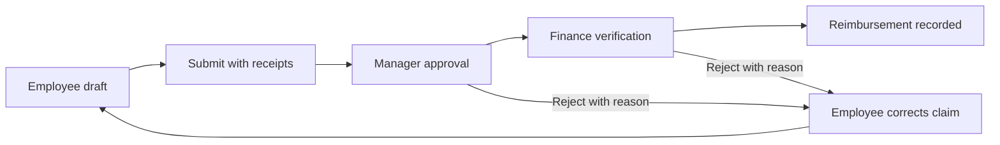
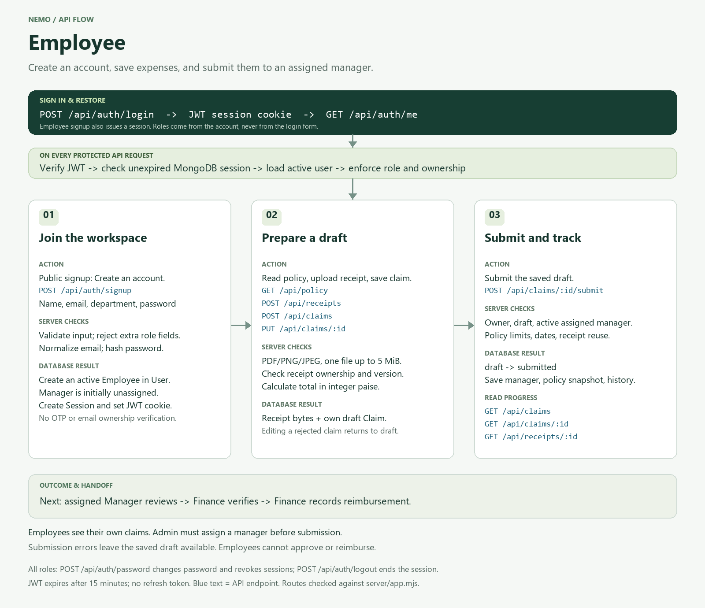

<div align="center">

# NEMO

### Expense claims. Clear approvals. Recorded reimbursements.

A college PBL project for managing employee expenses from the first receipt to the final accounting entry.

**React + TypeScript · Express · MongoDB · JWT · Docker**

[Installation](#installation-windows) · [Docker](#run-with-docker) · [API diagrams](docs/api-flows/README.md) · [Technical guide](tech.md)

</div>

---

## What Nemo does

- **Capture expenses:** multi-line claims, PDF/PNG/JPEG receipts, drafts, and resubmission.
- **Enforce policy:** category limits, claim limits, receipt requirements, and expense dates.
- **Route approvals:** assigned Manager review followed by Finance verification.
- **Record reimbursement:** payment date, method, reference, and balanced debit/credit entries.
- **Control access:** employee signup, JWT sessions, administrator-managed roles, and reporting managers.
- **Track activity:** claim history, administrative audit events, and CSV exports.

**Project scope:** one company, INR amounts, and internal reimbursement accounting. Nemo records payment details; it does not transfer money through a bank or payment gateway.

## Approval workflow



- **Employee:** creates and tracks personal claims.
- **Manager:** reviews assigned employee claims.
- **Finance:** verifies approved claims and records reimbursements.
- **Administrator:** manages people, roles, policy, and audit access.

New signups become Employees. An Admin must assign an active Manager before submission. Users cannot approve, verify, or record reimbursement of their own claims. Admin access alone does not grant Manager or Finance actions.

<details>
<summary><strong>View the Employee API flow</strong></summary>



[Manager](docs/api-flows/manager-api-flow.png) · [Finance](docs/api-flows/finance-api-flow.png) · [Administrator](docs/api-flows/admin-api-flow.png) · [All PNG/SVG diagrams](docs/api-flows/README.md)

</details>

## Installation (Windows)

### 1. Prerequisites

Install these tools and make them available in your terminal:

- **Node.js 22** with npm. The project requires Node 20.19 or later; Docker uses Node 22.
- **uv** for the project's isolated command environment.
- **Git** to clone the repository.
- **MongoDB Atlas** or a running MongoDB Community server. Compass is optional; it is a database viewer, not the server.
- **Docker Desktop** only if using the Docker instructions below.

### 2. Clone and install

Open PowerShell in the directory where you want to download the project, then run:

```powershell
git clone https://github.com/heyyash-input/Nemo.git
cd Nemo
uv venv .venv
uv run --no-project --python .venv/Scripts/python.exe npm.cmd ci
```

Already have the project? Open its existing folder instead of cloning over it. Use `npm.cmd ci` through the same uv command after pulling dependency changes.

### 3. Configure MongoDB and JWT

Create **one `.env` file** in the project root, beside `package.json`. Local development and Docker Compose both use it.

```dotenv
MONGODB_URI=mongodb+srv://<db-user>:<encoded-password>@<cluster-host>/nemo_expenses?retryWrites=true&w=majority
JWT_SECRET=<paste-your-generated-secret>
NODE_ENV=development
PORT=4000
APP_ORIGIN=http://127.0.0.1:4000
TRUST_PROXY=
```

For Atlas, use your cluster's connection string, a database user, and network access that permits your machine. Replace the placeholders; URL-encode special characters in the database password. `nemo_expenses` is the database name, and collections are created as the app initializes and saves records.

For a local MongoDB server, use `MONGODB_URI=mongodb://127.0.0.1:27017/nemo_expenses` instead.

Generate a private JWT signing key, then paste the output into `JWT_SECRET`:

```powershell
uv run --no-project --python .venv/Scripts/python.exe node -e "console.log(require('node:crypto').randomBytes(32).toString('hex'))"
```

Keep `.env` private. It is ignored by Git and excluded from the Docker build context. No SMTP configuration or extra `.env.docker` file is required.

### 4. Start Nemo

```powershell
.\Start.ps1
```

Open the URL printed by Vite, usually **http://127.0.0.1:5173**. If 5173 is occupied, Vite selects another available port and the launcher updates the API origin automatically. Stop with **Ctrl+C**.

The launcher uses uv, creates `.venv` if missing, and installs npm dependencies if `node_modules` is absent. It starts both the frontend and backend. VS Code Live Server is not the application server.

### 5. Create the first Administrator

For a new database, temporarily add your own values to the same `.env`:

```dotenv
ADMIN_EMAIL=your-email@example.com
ADMIN_PASSWORD="<your-unique-password>"
```

Use at least 10 characters and at most 72 UTF-8 bytes. In another terminal in the project folder, run:

```powershell
.\Start.ps1 -Task admin
```

Sign in using those credentials, then remove `ADMIN_PASSWORD` from `.env`. The command refuses if an Admin already exists; use that existing account to manage users instead.

### 6. Set up the approval team

1. Sign in as Admin and open **People & roles**.
2. Create a **Manager** and **Finance** account.
3. Have employees choose **Create an account**, or create them through the Admin screen.
4. Assign each Employee an active Manager.
5. After an Admin changes an account, that user signs in again because existing sessions are revoked.

Department is a label such as Engineering or Sales; it does not select a role. Public signup never grants elevated roles.

## Try a complete expense claim

1. **Employee:** upload a receipt, add expense lines, save, and submit.
2. **Manager:** open Approvals and approve the assigned claim.
3. **Finance:** verify the claim, then record its reimbursement date, method, and reference.
4. **Employee:** inspect the completed claim and history.
5. **Admin:** inspect the audit trail and company claims.

Receipts support PDF, PNG, and JPEG up to **5 MiB each**. Amounts are stored as integer paise. Rejection returns the claim to the owner for correction; saving the correction makes it a draft again.

<details>
<summary><strong>Optional local demo accounts</strong></summary>

To enable demo shortcuts, add these development-only settings to `.env`:

```dotenv
DEMO_MODE=true
DEMO_PASSWORD=NemoDemo@123
SEED_DEMO=false
```

Restart and use the role buttons, or sign in with password `NemoDemo@123`:

- Employee: `employee@nemo.demo`
- Manager: `manager@nemo.demo`
- Finance: `finance@nemo.demo`
- Admin: `admin@nemo.demo`

Missing demo accounts are created in the configured database; existing accounts/passwords are preserved. Changing DEMO_PASSWORD does not reset them. The demo Employee is assigned to the demo Manager.

These known credentials are for local demonstration. Production blocks demo access. Omit these settings for normal account setup. Advanced demo seeding and the optional local database fallback are documented in [tech.md](tech.md).

</details>

## Run with Docker

Start Docker Desktop. Use the same root `.env`, with a working `MONGODB_URI`, generated `JWT_SECRET`, `NODE_ENV=development`, and `APP_ORIGIN=http://127.0.0.1:4000` for local access. Keep demo seeding disabled.

From the project folder, after creating `.venv`:

```powershell
uv run --no-project --python .venv/Scripts/python.exe docker compose up --build -d
uv run --no-project --python .venv/Scripts/python.exe docker compose ps
```

Open **http://127.0.0.1:4000**. Compose runs one service named `nemo`; it does not create a MongoDB server. Atlas works when its network access permits the connection. For MongoDB running on your Windows host, use `host.docker.internal` in the URI instead of `127.0.0.1`.

View logs or stop the container:

```powershell
uv run --no-project --python .venv/Scripts/python.exe docker compose logs nemo
uv run --no-project --python .venv/Scripts/python.exe docker compose down
```

After editing `.env`, recreate the container with `docker compose up -d --force-recreate` through the same uv prefix. Local Node and Docker normally both use API port 4000; stop one before starting the other.

## Build and verify

```powershell
.\Start.ps1 -Task build
.\Start.ps1 -Task test
.\Start.ps1 -Task format:check
```

- **Build:** TypeScript checks and Vite production assets in `dist/`.
- **Tests:** authentication, role access, policy rules, uploads, approval order, concurrent updates, and reimbursement accounting.
- **Formatting:** checks source style without rewriting it.

The JWT integration run passed **36 tests with 0 failures**, and the production build passed. Tests use isolated temporary MongoDB databases, not your Atlas records. This is a recorded result, not a live CI badge or load-test guarantee.

To run the built frontend and API together:

```powershell
.\Start.ps1 -Task start
```

Use `APP_ORIGIN=http://127.0.0.1:4000` and open that address. Run the build first.

## Authentication and deployment status

- Passwords are hashed with bcrypt; JWTs use HttpOnly cookies and expire after **15 minutes**.
- Logout, password changes, and account updates revoke database sessions. There is no refresh token; users sign in again after expiry.
- Signup does not verify email ownership. OTP, password recovery, and external identity providers are not implemented.
- Public deployment requires `NODE_ENV=production`, an HTTPS `APP_ORIGIN`, a private `JWT_SECRET`, a reachable MongoDB URI, and disabled demo/seed flags.
- Dependency advisories, backups, monitoring, receipt malware scanning, and realistic load testing remain deployment work. See [current limitations](tech.md#10-current-limits-and-future-work).

## Troubleshooting

- **PowerShell blocks Start.ps1:** for this terminal only, run `Set-ExecutionPolicy -Scope Process RemoteSigned`, then retry.
- **API port 4000 is busy:** stop the earlier Node process/container, or set another PORT. For direct Express/Docker access, update APP_ORIGIN to match.
- **MongoDB will not connect:** check the URI, database credentials, Atlas network access, or whether the local MongoDB server is running.
- **“Assign an active manager”:** an Admin must set the employee's reporting manager before submission.
- **“This request origin is not allowed”:** use the printed Vite URL in development; use the exact APP_ORIGIN for direct Express/Docker access.
- **Login expires:** sign in again; the current JWT lifetime is 15 minutes, even during active use.

## Explore the project

- [Application flow](flow.md): signup, JWT, approvals, and accounting explained step by step.
- [Technical guide](tech.md): stack, API contracts, database records, environment settings, and tests.
- [API diagram gallery](docs/api-flows/README.md): all four roles as PNG and SVG.

```text
src/                 React interface, typed API client, and role screens
server/app.mjs       API routes, authentication, permissions, and workflow
server/models.mjs    MongoDB schemas and indexes
server/domain.mjs    Input validation, policy rules, and journal entries
server/tests/        Isolated automated tests
Start.ps1            Windows launcher using uv
Dockerfile           Application image
compose.yaml         Local container configuration
```

---

**Nemo · BCC75 college PBL project**
