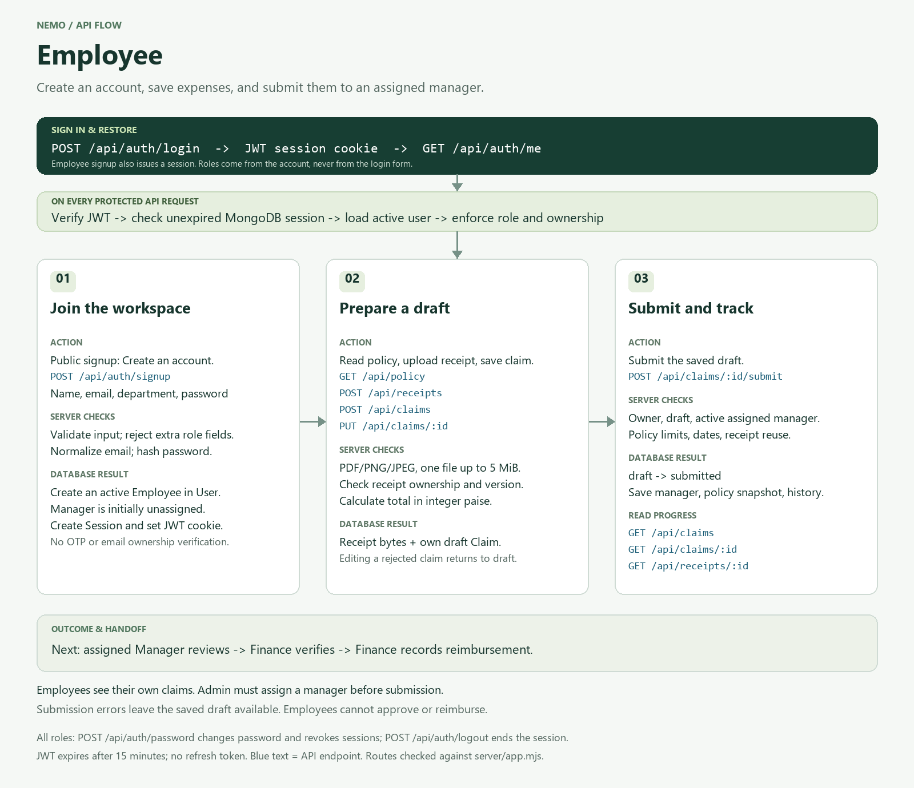
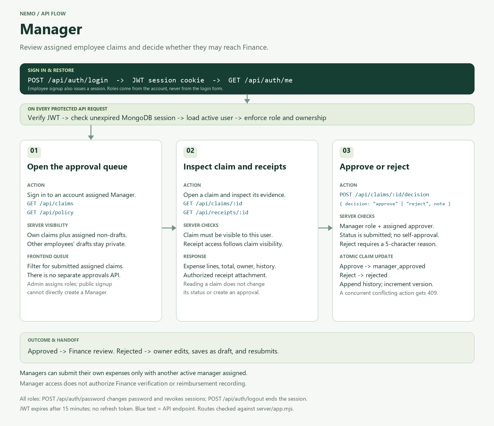
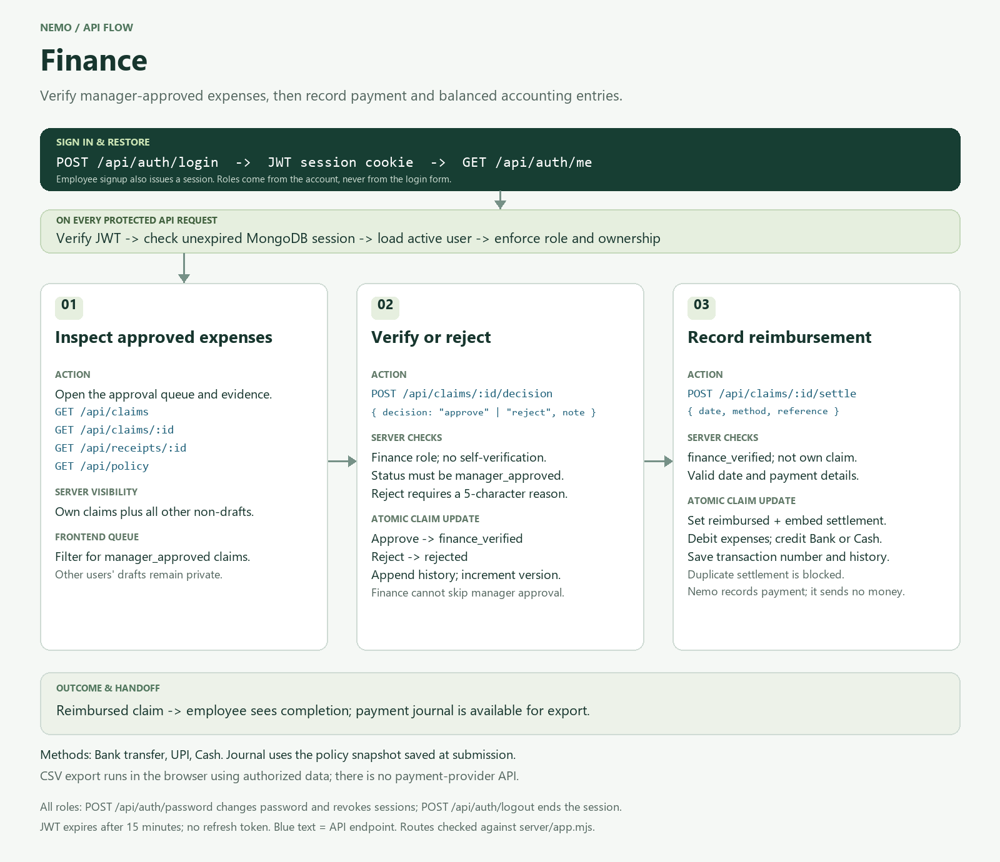
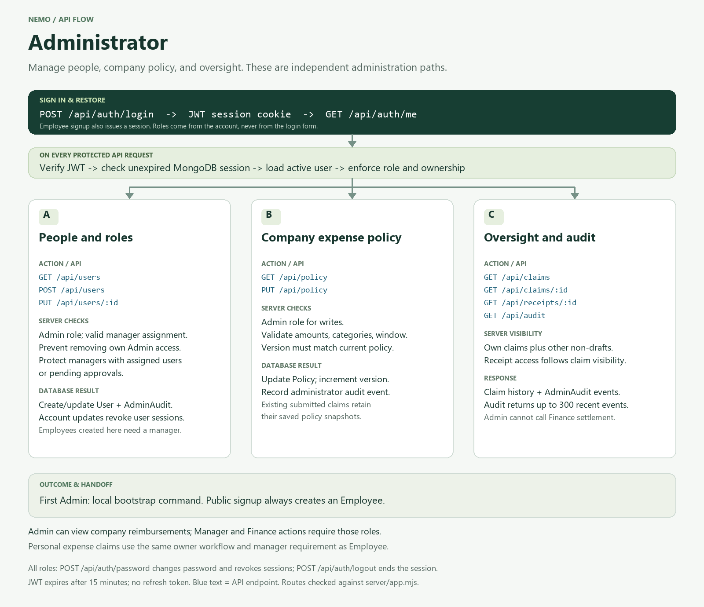

# API flows by role

Each diagram follows the actual routes and access checks in `server/app.mjs`. PNG files are ready for reports and slides; SVG files stay sharp when zoomed or printed.

The shared header shows authentication and protected-request validation. Employee signup is public; its JWT allows subsequent protected calls. The Admin diagram branches into independent tasks rather than a mandatory sequence.

Managers, Finance, and Admin can also create personal claims through the owner workflow shown in Employee. Submission still needs an active assigned manager, and self-approval/verification/reimbursement is blocked. All roles can change their password and sign out.

## Employee

[PNG](employee-api-flow.png) | [SVG](employee-api-flow.svg)

## Manager

[PNG](manager-api-flow.png) | [SVG](manager-api-flow.svg)

## Finance

[PNG](finance-api-flow.png) | [SVG](finance-api-flow.svg)

## Administrator

[PNG](admin-api-flow.png) | [SVG](admin-api-flow.svg)

For the complete explanation, read [flow.md](../../flow.md) and [tech.md](../../tech.md). These diagrams document implementation; they do not represent deployment or load-test results.
