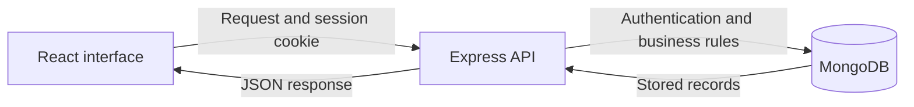
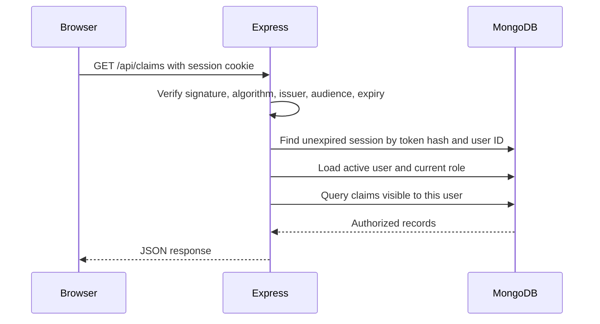
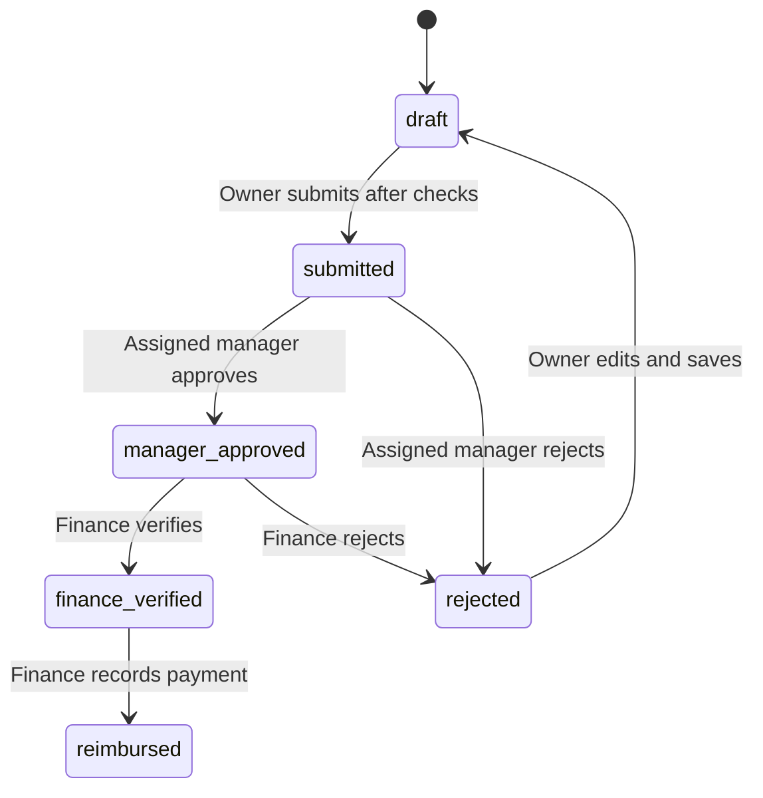

# Nemo: application flow

This guide describes the current implementation after JWT and employee signup were added. Read [tech.md](tech.md) for the stack, API routes, configuration, and testing. Source paths are relative to the project root.

## API flow images by role

See the [role diagram gallery](docs/api-flows/README.md) for Employee, Manager, Finance, and Administrator API flows. Each image is available as PNG and SVG.

## 1. What the application does

Nemo records employee business expenses, routes them to a reporting manager, lets Finance verify them, and stores reimbursement details and accounting entries. It currently represents one company with one expense policy, without separate company tenants.

1. An employee registers.
2. An administrator assigns an active reporting manager.
3. The employee uploads receipts and saves a draft.
4. Submission validates company policy and sends the claim to its manager.
5. The manager approves or rejects it.
6. Finance verifies or rejects a manager-approved claim.
7. Finance records a payment handled outside Nemo.
8. Nemo stores the payment reference and balanced journal entries.

## 2. Browser, server, and database

The browser manages forms and presentation. Express validates inputs, identifies the user, and enforces business rules. MongoDB persists accounts, claims, receipts, and related records. The browser never receives the MongoDB credentials or directly connects to the database.

In development, Vite serves React and proxies `/api` requests to Express. After a production build, Express can serve both the compiled frontend and API from one origin.

## 3. Startup and restoring a login

1. `Start.ps1` runs the selected task through the project's uv environment. Node runs the application; Python is only part of environment tooling.
2. `server/dev.mjs` loads `.env`, starts Vite, and sets the API's allowed origin to the actual Vite URL. Vite can choose another port if 5173 is occupied.
3. `server/index.mjs` validates configuration, connects to MongoDB, initializes indexes and the policy, and performs explicitly enabled demo setup before listening.
4. `src/main.tsx` mounts React. `src/App.tsx` calls `/api/config` and `/api/auth/me`.
5. A valid session restores the workspace; otherwise the account form appears.
6. After login, claims and policy are loaded. Role-aware navigation determines the visible screens, while the API independently enforces permissions.

Stopping the app closes HTTP/database connections without deleting Atlas records.

## 4. Employee signup

The form in `src/AuthPage.tsx` collects full name, email, department, and password. Department is a text label such as Engineering or Sales. It does not determine permissions or the approver.

`POST /api/auth/signup` runs the following steps:

1. Apply request-origin/header checks and authentication rate limiting.
2. Validate the fields. Passwords need at least 10 characters and at most 72 UTF-8 bytes. Email is normalized to lowercase.
3. Reject extra fields such as `role`, `active`, and `managerId`, and reject reserved `.demo` emails.
4. Hash the password with bcrypt, using cost 12.
5. Create an active Employee with no manager assigned.
6. Issue a JWT cookie and return the public profile with HTTP 201.

A unique email index prevents duplicate accounts. Password hashes are excluded from the response. SMTP, OTP, and email ownership verification are not implemented.

New users can save drafts, but must have an active manager assigned before submission. Public signup cannot create Admin, Manager, or Finance accounts. Existing administrators assign these roles through People & roles.

### Sample signup inputs

These are form examples, not automatically created accounts:

- Asha Rao; `asha.employee@example.com`; Engineering; sample password `NemoSample!2026A`.
- Ravi Shah; `ravi.employee@example.com`; Sales; sample password `NemoSample!2026B`.

Use your own email and a unique private password for real accounts. First-administrator setup is described in [tech.md](tech.md).

## 5. Exactly how JWT works in Nemo

JWT means JSON Web Token. It has three encoded sections: `header.payload.signature`.

- The header identifies the token format and signing algorithm.
- The payload contains the server's claims about the session.
- The signature lets the server verify the token and detect changes.

JWT contents are readable, not encrypted. Nemo puts no passwords, receipts, expense details, or database connection strings in them.

### Signing a token

After signup or successful password verification, `signIn()` in `server/app.mjs`:

1. Deletes the session corresponding to an existing browser session cookie, if present.
2. Signs a JWT with HS256 and the private `JWT_SECRET`.
3. Stores a SHA-256 hash of the full token, user ID, and expiry in MongoDB's Session records.
4. Sets the `session` cookie and returns the public profile.

The JWT contains:

- `sub`: MongoDB user ID.
- `jti`: randomly generated token identifier.
- `iss`: issuer `nemo`.
- `aud`: audience `nemo-web`.
- `iat`: issue time.
- `exp`: expiry, 15 minutes after issue.

The role is loaded from MongoDB on requests rather than copied into the token.

### Browser storage

The browser receives the token through a Set-Cookie response header. The cookie is HttpOnly, SameSite=Strict, scoped to `/api`, and valid for 15 minutes. Production adds Secure, requiring HTTPS.

HttpOnly prevents frontend JavaScript from reading the cookie. The browser sends it automatically on API requests using `credentials: 'same-origin'` in `src/api.ts`. Nemo does not store the JWT in localStorage or require a frontend Authorization bearer header.

### Validating a protected request

The signature is only one check. The token also needs a valid database session and an active user. Keeping the database session permits immediate revocation; JWT does not remove MongoDB reads in this design.

Authentication establishes which account sent a request. Authorization decides which actions that account may perform. The backend handles both. Hiding a frontend button is not an access-control boundary.

### Expiry and revocation

- **Expiry:** 15 minutes after issue, including during active use. There is no refresh token or automatic renewal. The next protected request fails and the user signs in again.
- **Logout:** deletes the matching session and clears the cookie. Replaying the token then fails even before its expiry.
- **Password change:** checks the old password, stores a new hash, deletes all the user's sessions, and clears the cookie.
- **Admin account update:** revokes the affected user's sessions, requiring a new login.
- **Deactivation:** protected requests require an active user.
- **Signing-key rotation:** changing JWT_SECRET invalidates tokens signed with the old key.

MongoDB's expiry index eventually cleans up old sessions. Requests check expiry explicitly, so access does not depend on immediate cleanup.

A 401 from a non-authentication API call triggers the frontend's session-expired event, clearing private workspace state. Reloading also checks `/auth/me`. There is no countdown that removes an already-rendered page exactly at the expiry second.

## 6. Roles and record visibility

- **Employee:** creates and views their own claims, uploads receipts, edits their drafts/rejected claims, and submits eligible drafts.
- **Manager:** additionally sees assigned non-draft claims and decides submitted claims. A manager needs another active manager assigned to submit their own expenses.
- **Finance:** sees their own claims and other non-draft claims, verifies manager-approved claims, and records reimbursements.
- **Admin:** manages people, roles, managers, and policy; sees audit history and non-draft company claims. Admin access alone does not authorize Manager decisions or Finance settlement actions.

Other users' drafts remain private. Receipts are downloadable by the owner or an authorized viewer of a claim containing them. Nobody may approve, verify, or record reimbursement of their own claim.

## 7. Receipts and drafts

1. The employee uploads a PDF, PNG, or JPEG to `/api/receipts` using multipart field `receipt`.
2. Multer accepts one file up to 5 MiB (5 × 1024 × 1024 bytes). The backend checks its file signature.
3. MongoDB stores the binary file and ownership metadata. The frontend attaches the returned receipt ID to an expense line.
4. Saving creates a draft through `POST /api/claims` or updates it through `PUT /api/claims/:id`.
5. The backend verifies receipt ownership, rejects reuse of a receipt ID within a claim, and calculates the total itself.

Claims contain 1–20 items. Monetary values use integer paise: INR 125.50 is `12550`. Dates must be valid calendar dates.

Saving and submitting are separate requests. If save succeeds but submission fails, the draft remains available for correction. This explains “Draft ... is saved. Resolve any policy errors and submit when ready.”

## 8. Submission and approval

Submission requires an active manager and checks the current policy: total claim cap, allowed categories, per-line category limits, required receipts, no future expense dates, and the submission window. It also rejects receipt IDs already committed to another non-draft, non-rejected claim.

The server saves the manager ID, submission time, submitted receipt reservations, and a policy snapshot. Later policy changes do not alter accounting mappings on already-submitted claims.

A Manager decides only submitted claims assigned to them. Finance verifies only manager-approved claims. Rejection requires a reason of at least five characters. Rejection releases submitted receipt reservations. Editing a rejected claim returns it to draft, and it must pass submission checks again.

## 9. Reimbursement and accounting

Finance enters a payment date, method (Bank transfer, UPI, or Cash), and reference. The claim must be finance-verified, and the date must fall within the allowed submission-to-today interval.

Nemo generates a transaction number and records the payment information, total, acting Finance user's name, and journal entries derived from the saved policy. Example: INR 1,000 Travel plus INR 200 Meals, paid by bank transfer:

- Debit Travel expense: INR 1,000.
- Debit Meals expense: INR 200.
- Credit Bank: INR 1,200.

Cash payments credit Cash; UPI and bank transfers credit Bank. Entries for a shared expense account are combined. Debits equal credits.

Settlement, journal, status, and history are saved in one conditional claim update. There is no separate financial transaction collection. Nemo records payment details without calling a bank or moving money. The implemented accounting is a simplified reimbursement journal without accruals, tax handling, or reversal workflows.

## 10. Concurrent changes and audit history

Claims have a `__v` version field. Updates match the expected status and version, increment the version, and append history. A conflicting action receives HTTP 409 instead of overwriting another update. A unique sparse index on submitted receipt IDs prevents simultaneous reuse across claims.

Claim history stores actor, role, action, note, and time. Administrative user/policy changes are stored in AdminAudit. The audit API combines these sources. CSV files are generated in the browser from already-authorized data.

These protections address conflicting writes. They do not establish how many users the deployed infrastructure can support; that requires a separate load test.

## 11. Demonstrate the full project

1. Register Asha and sign out.
2. Sign in as your existing Admin. Ensure Manager and Finance accounts exist, and assign Asha an active Manager in People & roles.
3. Sign in as Asha again. Upload a receipt, save a valid expense, and submit it.
4. Sign in as the assigned Manager and approve it.
5. Sign in as Finance, verify it, and record payment details.
6. Sign in as Asha to view the completed claim and history; inspect the journal on the reimbursed claim.

To demonstrate rejection, reject at the Manager or Finance stage with a reason, then let Asha edit and resubmit. Use separate accounts to show that self-approval is blocked.
